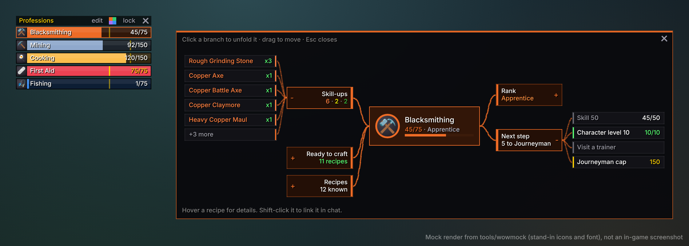
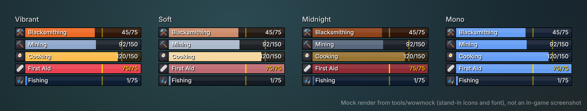
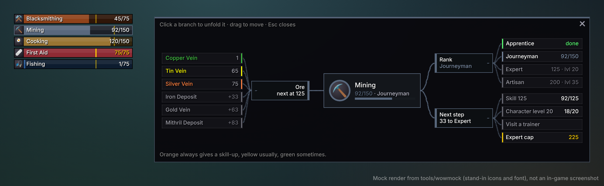

# Profession Bars

Slim, colour-themed skill bars for your professions in World of Warcraft: Forever.
Click a bar and that profession opens as a mind map. The map shows your rank, what it
takes to reach the next one, which recipes still give skill-ups, what you can craft
right now and where your gathering skill stands.



*These images come from the headless test harness (`tools/wowmock`), so they use
stand-in icons and fonts. They are not in-game screenshots.*

## Install

1. Get this folder. On GitHub use **Code → Download ZIP**, then unzip it and find
   `addons/ProfessionBars`.
2. Copy the `ProfessionBars` folder into your Forever client's `Interface/AddOns`
   folder. That client folder sits inside your World of Warcraft directory and has
   `Interface` and `WTF` in it (the beta used `_classic_beta_`). The result must be
   `.../Interface/AddOns/ProfessionBars/ProfessionBars.toc`.
3. On the character select screen, open **AddOns** and tick **Profession Bars**.

The addon targets interface `16001` (Forever 1.60.1). If a later patch marks it as
out of date, tick *Load out of date AddOns* or update the number on the
`## Interface:` line. `/run print(select(4, GetBuildInfo()))` prints the current number.

## Using it

- **Bars.** One bar per profession: primaries first, then Cooking, First Aid and Fishing.
  The thin gold tick marks the skill where you can train the next rank. The numbers
  turn gold when you can train it right now, and a bar flashes when you skill up.
- **Click a bar** to open its mind map. Click it again (or press Esc) to close it.
- **Hover the bars** to show a small header:
  - **edit** lets you click bars to show or hide them.
  - **The colour square** switches theme.
  - **lock** stops the bars from being dragged.
  - **x** hides the bars.

  Drag the header to move the bars.
- **Toggle everything** with `/pb`, a key binding (Key Bindings → AddOns → Profession
  Bars), or the minimap addon menu.



## The mind map

Your profession sits in the middle. Click a branch to unfold it, or click the centre to
unfold or fold all of them. Hover anything for details.

| Branch | Shows |
| --- | --- |
| **Rank** | Apprentice, Journeyman, Expert and Artisan, and which you have done. |
| **Next step** | Skill and character level needed for the next rank, and whether you can train now. |
| **Skill-ups** | Your orange and yellow recipes, with how many you can craft from your bags. |
| **Ready to craft** | Everything you have the reagents for right now. |
| **Recipes** | Known recipes by category. |
| **Ore / Herbs** | Nodes coloured by skill-up chance, plus the next unlocks and the skill still needed. |
| **Beasts** | The highest level you can skin, the best levels for skill-ups and the next milestones. |

Recipes load the first time you open a profession's window on a character, because
the game only shares recipe colours then. The map tells you when it needs that, and
when the colours are older than your current skill. Shift-click a recipe to link it
in chat.



## Commands

| Command | What it does |
| --- | --- |
| `/pb` | Show or hide the bars. |
| `/pb <profession>` or `/pb map <profession>` | Open a profession's map, e.g. `/pb mining`. |
| `/pb edit` | Choose which professions get a bar. |
| `/pb hide <profession>`, `/pb show <profession\|all>` | Hide or show one bar. |
| `/pb theme [vibrant\|soft\|midnight\|mono]` | Set the theme, or cycle with no name. |
| `/pb color <profession> <#rrggbb\|reset>` | Give one profession your own colour. |
| `/pb lock`, `/pb unlock` | Stop or allow dragging. |
| `/pb scale <0.5-2>`, `/pb mapscale <0.5-2>`, `/pb width <140-400>` | Sizes. |
| `/pb combat` | Hide the bars while in combat (toggle). |
| `/pb reset` | Reset position, size, theme and colours. |
| `/pb debug` | Print which game APIs the addon found and what they returned. |

## Notes

- Forever uses the modern (Mainline) addon API. The addon reads skills with
  `GetProfessions`/`GetProfessionInfo` and fills gaps (for example First Aid) from
  `C_TradeSkillUI`. Every call is guarded, so a missing function only loses that
  piece of data. If a bar looks wrong, `/pb debug` shows what the client returned.
- Rank thresholds, trainer levels and node levels are Classic values kept in
  `Data.lua`. Forever may change some of them, and new zones may add nodes. They are
  easy to edit there.
- Everything stays on your machine, in `ProfessionBarsDB` (account) and
  `ProfessionBarsCharDB` (per character).

## Development

The addon runs headless against a mock of the WoW API in `tools/wowmock`. From the
repository root:

```sh
lua5.1 tools/wowmock/run.lua        # ~2,600 checks: scanning, bars, map layout, commands
luacheck addons/ProfessionBars      # lint (config in .luacheckrc)
```

`tools/wowmock/README.md` explains how to render the preview images.
