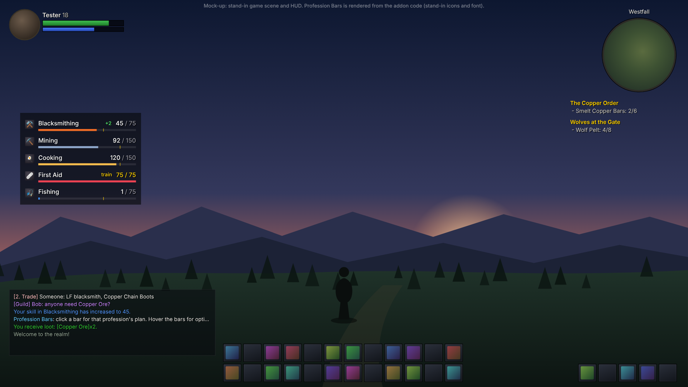
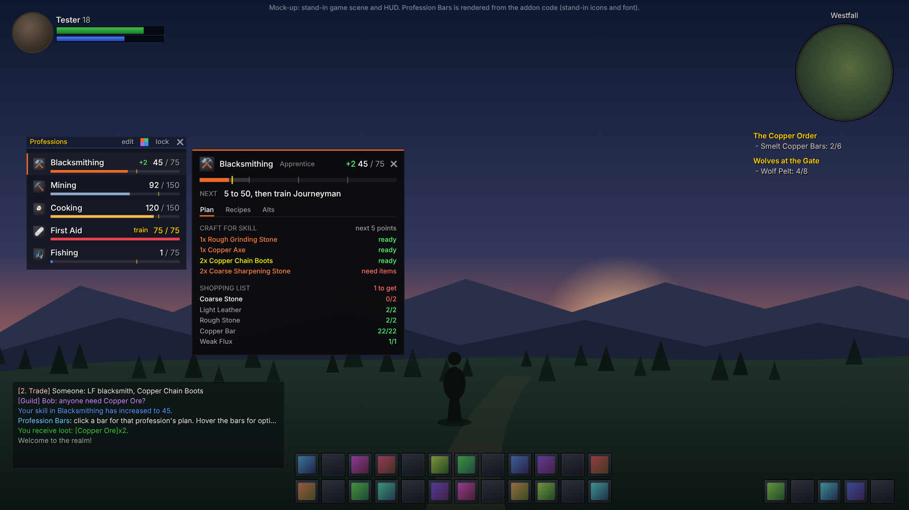
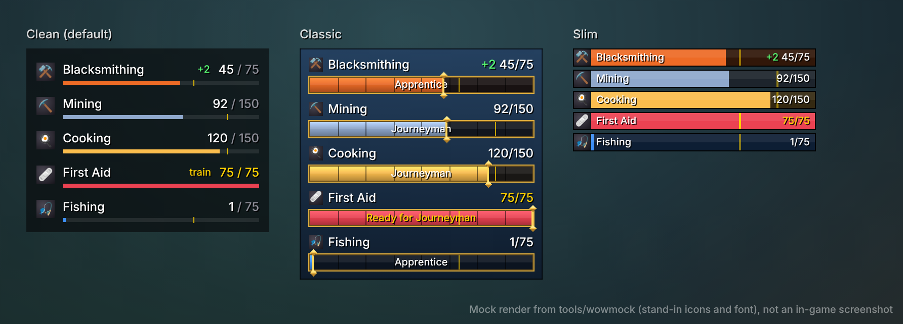
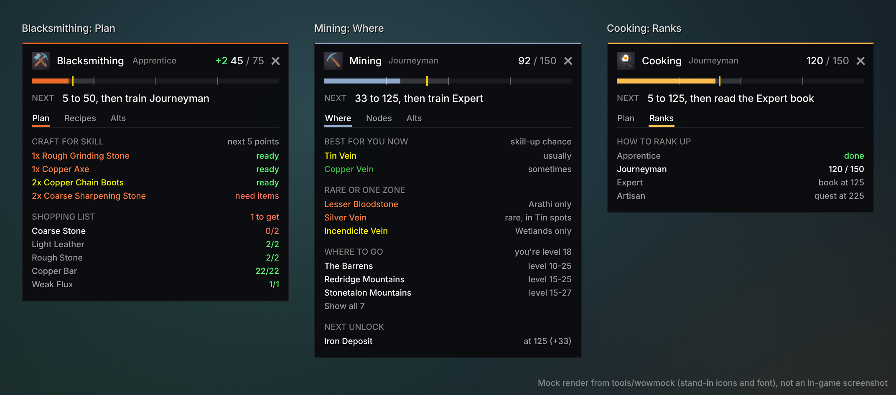

# Profession Bars

Colour-themed skill bars for your professions in World of Warcraft: Forever, in a
minimal clean style (the default), a framed classic style or a compact slim style.
Click a bar and that profession's panel opens beside it. The panel shows:
- your skill, your rank and one line saying what to do next;
- a plan for the next skill points, with the reagents you're missing;
- for gatherers, the nodes worth farming now and the zones to find them in;
- how Cooking, First Aid and Fishing are ranked up (trainer, book or quest);
- which of your other characters have the same profession.


*These images come from the headless test harness (`tools/wowmock`), so they use
stand-in icons and fonts. They are not in-game screenshots.*

### On a 1080p screen

At the default position and scale, with a stand-in game scene and placeholder HUD.
In normal play the bars sit on the left, between your unit frame and chat:



With a profession's panel open beside the bars:



## Install

1. Get this folder. On GitHub use **Code → Download ZIP**, then unzip it and find
   `addons/ProfessionBars`.
2. Copy the `ProfessionBars` folder into your Forever client's `Interface/AddOns`
   folder. That client folder sits inside your World of Warcraft directory and has
   `Interface` and `WTF` in it (the beta used `_classic_beta_`). The result must be
   `.../Interface/AddOns/ProfessionBars/ProfessionBars.toc`.
3. On the character select screen, open **AddOns** and tick **Profession Bars**.

The addon targets interface `16001` (Forever 1.60.1). If a later patch marks it as
out of date, tick *Load out of date AddOns* or update the number on the
`## Interface:` line. `/run print(select(4, GetBuildInfo()))` prints the current number.

## Using it

- **Bars.** One bar per profession: primaries first, then Cooking, First Aid and Fishing.
  Pick a style with `/pb style`:
  - **Clean (the default).** Icon, name and `45 / 75` above a thin colour line, on a
    flat translucent panel. A small gold tick marks where the next rank can be trained.
    Once you can train, the numbers turn gold and a small *train* appears. A green
    **+N** shows the skill you've gained this session. Nothing else is drawn.
  - **Classic.** The name and value sit above a gold-framed bar with your rank written
    inside, and a gold marker with diamond ends sits at your current skill.
  - **Slim.** One compact bar per profession with the text inside.
  - `/pb fade` dims the bars until you hover them. A skill-up wakes them for a moment.
  - Hover a bar to see which of your other characters have that profession.
- **Click a bar** to open its panel beside the bars, on whichever side has room.
  Click the bar again, or press Esc, to close it. Click another bar to switch.
- **Hover the bars** to show a small header:
  - **edit** lets you click bars to show or hide them;
  - **the colour square** switches theme;
  - **lock** stops the bars from being dragged;
  - **x** hides the bars.

  Drag the header to move the bars.
- **Toggle everything** with `/pb`, a key binding (Key Bindings → AddOns → Profession
  Bars), or the minimap addon menu.




## The panel

The top of the panel is the same for every profession:
- **Header.** Name, rank and skill, with a green **+N** for this session's gain.
- **Track.** The whole 0-300 range. The bright part is your skill, the lighter part is
  what your rank lets you reach, and the gold mark is where the next rank can be
  learned. Hover it for every rank's cap.
- **NEXT.** One line saying what to do next, such as *5 to 50, then train Journeyman*,
  *Reach level 20 for Expert* or *5 to 125, then read the Expert book*. Hover it for
  details. It turns green when you can learn the next rank now, and red when only
  your character level is holding you back.

Below that are tabs. Only the ones with something to show appear, and the panel
remembers the last tab you used for each profession.

| Tab | Shows |
| --- | --- |
| **Plan** | Crafts for the next skill points, at most ten points ahead (recipe colours change as you level). Orange recipes come first; yellow ones count as half a point, because they only skill up about half the time. Crafts your bags already cover say *ready*. The shopping list below shows what's missing, in red. Mining's version is called **Smelting**. |
| **Recipes** | Known recipes, orange first, with how many you can make from your bags. |
| **Camp** | Camp recipes you know. It only appears when the game lists recipes under a camp name. |
| **Where** | For Mining and Herbalism, the nodes that give skill-ups now, best first. Rare spawns and one-zone nodes (Silver, Incendicite, Black Lotus...) are listed apart, with where to find them, and are never suggested as farming targets. Then zones for your skill bracket, those that suit your level first, and the next unlock. For Skinning, the beast levels to skin and the zones to find them. |
| **Nodes** | Every node with the skill it needs. |
| **Ranks** | For Cooking, First Aid and Fishing: how each rank is learned. Expert comes from a book and Artisan from a quest, and the tooltips name them. |
| **Alts** | Your other characters with this profession, in class colours. |

Long lists end with *Show all N*. Hover anything for details. Shift-click a recipe to
link it in chat.

Recipes load the first time you open a profession's window on a character, because
the game only shares recipe colours then. The panel tells you when it needs this, and
when the colours are older than your current skill. Bag counts update live.




## Commands

| Command | What it does |
| --- | --- |
| `/pb` | Show or hide the bars. |
| `/pb <profession>` | Open a profession's panel, e.g. `/pb mining` or `/pb first aid`. |
| `/pb edit` | Choose which professions get a bar. |
| `/pb hide <profession>`, `/pb show <profession\|all>` | Hide or show one bar. |
| `/pb style [clean\|classic\|slim]` | Minimal, framed or compact bars. Cycles with no name. |
| `/pb fade` | Dim the bars until you hover them (toggle). |
| `/pb theme [vibrant\|soft\|midnight\|mono]` | Set the theme, or cycle with no name. |
| `/pb color <profession> <#rrggbb\|reset>` | Give one profession your own colour. |
| `/pb lock`, `/pb unlock` | Stop or allow dragging. |
| `/pb scale <0.5-2>`, `/pb panelscale <0.5-2>`, `/pb width <140-400>` | Sizes. |
| `/pb combat` | Hide the bars while in combat (toggle). |
| `/pb alts`, `/pb forget <name>` | List your other characters' professions, or forget one. |
| `/pb reset` | Reset position, size, style, fade, theme, colours and tabs. Alts and recipes are kept. |
| `/pb debug` | Print which game APIs the addon found, what they returned and the last error. |

## Known limitations

- **Not yet run on the live client.** Everything is tested against a mock of the
  game's API (below). If something looks off, `/pb debug` shows what the client
  returned.
- **Plans are short on purpose.** They look ten points ahead, use orange and yellow
  recipes, and only count what's in your bags. They ignore the bank and auction
  prices.
- **Classic numbers.** Rank requirements (including the secondary professions' books
  and quests), node skills and zone levels are Classic values in `Data.lua`. Forever
  may change some of them, and its new zones aren't listed yet.
- **Zones ignore faction.** The Where tab lists every zone for your skill bracket,
  Alliance or Horde.
- **Sessions.** Session gains survive a `/reload`. Logging back in after more than
  ten minutes away starts a new session.
- **English only.** The addon's own text is in English.
- **Alts appear after one login.** Each character shows up once you've logged in on
  it with the addon enabled.

## Notes

- Forever uses the modern (Mainline) addon API. The addon reads skills with
  `GetProfessions`/`GetProfessionInfo` and fills gaps (for example First Aid) from
  `C_TradeSkillUI`.
- Every API call is guarded. If something still fails, it's reported once in chat
  and the rest keeps working, instead of erroring on every event.
- Everything stays on your machine, in `ProfessionBarsDB` (account) and
  `ProfessionBarsCharDB` (per character).

## Development

The addon runs headless against a mock of the WoW API in `tools/wowmock`. From the
repository root:

```sh
lua5.1 tools/wowmock/run.lua        # ~3,400 checks: scanning, bars, plans, panel layout, commands
luacheck addons/ProfessionBars      # lint (config in .luacheckrc)
```

`tools/wowmock/README.md` explains how to render the preview images.
